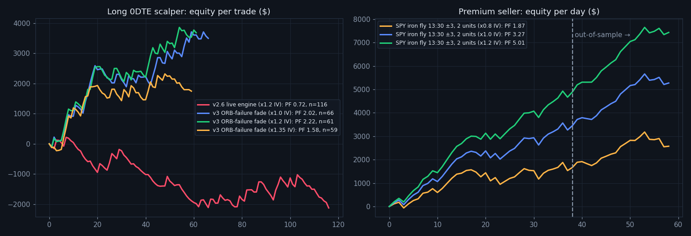

# 0DTE Edge Research — v3.0 (2026-11-09)

**Data:** SPY + QQQ 5-minute bars, 58 trading days (2026-08-14 → 2026-11-06), cached in `data/cache/` and extended on every run.
**Walk-forward:** in-sample (IS) = first 38 days (to 2026-10-09), out-of-sample (OOS) = last 20 days (from 2026-10-12). Parameters were picked on IS only.
**Engine:** `replay.py` runs the *live* code paths: `score_bars`, `compute_levels`, `select_best_contract`, `decide_exit`, and the session/risk limits. Parity check: replay signals match the daemon's real 11/4 and 11/6 entries within one bar. The ORB-fade run through the live engine reproduces the research rule (66 vs 67 trades, same PF).

## Verdict

| Strategy | Trades | PF | P&L | Max DD | IS PF → OOS PF |
|---|---|---|---|---|---|
| v2.6 live engine (what was running) | 116 | **0.72** | −$2,126 | −$2,342 | <1 → <1 |
| **v3 ORB-failure fade** (long 0DTE, now live) | 61 | **2.22** | +$3,683 | −$495 | 2.27 → 2.15 |
| **SPY iron fly 13:30 ±3, 2 units** (short 0DTE, now live) | 58 days | **3.27** | +$5,273 | −$448 | 3.05 → 3.83 |

Long-option numbers are priced at **1.2× VIX IV**. That matches real SPY/QQQ 0DTE straddles observed 2026-11-09 (mid $3.61 vs $3.01 modeled; both symbols at 1.20×). Iron-fly numbers use 1.0× VIX (credit received), with 0.8× and 1.2× shown in `equity_v3.png`.



## What was learned

1. **The old engine had no edge.** `edge_scan.py` measures the signed forward SPY/QQQ move after each signal, before any option pricing. The full v2.6 engine was −2.6 bps over 30 minutes OOS on SPY. The PDH/PDL "liquidity sweep" setup was reliably wrong (−17 to −48 bps OOS on QQQ). No exit setting can fix entries like that.
2. **Option pricing assumptions decide everything for long scalps.** The first sweep found nine "profitable" live-engine configs at 1.0× VIX. Every one turned negative in-sample at 1.2×, the realistic level. Don't trust a long-option backtest that prices at VIX.
3. **ORB-failure fade is the long-side edge.** Trigger: a 5-minute bar closes outside the 9:30–9:45 opening range, then the next bar closes back inside. Trade back through the range, between 9:45 and 11:30 ET, on completed bars only.
   - It stays positive under every pricing stress (1.0× / 1.2× / 1.35× / 1.5× IV give PF 2.02 / 2.22 / 1.58 / 1.37) and with triple slippage (PF 2.01).
   - It works on each symbol alone (SPY 1.58, QQQ 2.63) and on both sides.
   - Monthly: August PF 4.1, September 2.1, October 2.1, November 0.79 (−$68 over 6 trades).
   - The exits matter: a wide −60% backstop instead of a tight premium stop, no underlying-invalidation exit, TP +50/+100% with no scale-out, and a 60-minute time stop. About a third of trades hit +100%, and those pay for everything else.
4. **Selling afternoon premium is the strongest edge found.** A SPY ATM iron butterfly opened 12:30–14:00 is profitable at *every* entry time and wing width tested (2–5 points), with PF 2.4–3.3 overall and OOS PF ≥ 1.3. 13:00–13:30 is the most stable. It survives collecting only 80% of the modeled premium (PF 1.87). QQQ is weaker and less stable, so it's SPY only.
   - **Risk:** November so far (6 days, VIX ~21, trending tape) lost on every variant. Trend days are the failure mode. Max loss is capped at about $294/day at 2 units.
5. **Dead ends:** ORB breakouts and opening-range breakouts (negative or regime-flipping), VWAP reclaim, trend-day EMA9 pullbacks, RSI/VWAP-stretch mean reversion, gap fade, 10:30 trend drift, 14:00 momentum. Gap-and-go looked strong OOS but has only 30 trades; treat it as noise until there's more data.

## Honest limits

- 58 days, about 60 long trades, and 58 fly days are small samples. The cache grows each run (`python research/replay.py`), so re-run `sweep.py` monthly.
- Options are modeled with Black-Scholes at prior-day VIX/VXN, without skew. The real tests are the **paper ledgers**: both strategies paper-fill on real chain quotes. The daemon also logs `data/iv_calibration.jsonl` (real 0DTE straddle vs model every 30 minutes) and `data/signal_journal.jsonl` (every decision), so model assumptions can be checked against reality.
- Signals use completed 5-minute bars (live v3 does too, via `completed_bars_only`).

## Paper-trading checkpoint

Run 4 weeks of paper, then compare with the backtest:
- ORB fade: expect about 1 trade per day, PF > 1.3. If it's < 1.0 after 25+ trades, the edge isn't transferring.
- Iron fly: expect about 75% win days, mean IV-calibration ratio ≥ 0.9 at 13:30. If the ratio is < 0.8, credits are thinner than modeled, so re-run `premium.py` with that multiplier.

## Reproduce

```bash
cd zero_dte_scalper/research
../../venv/bin/python replay.py            # live config replay + breakdowns
../../venv/bin/python edge_scan.py         # directional edge of every rule
../../venv/bin/python sweep.py             # rules x exits x pricing walk-forward
../../venv/bin/python premium.py           # iron fly / condor grid
```
